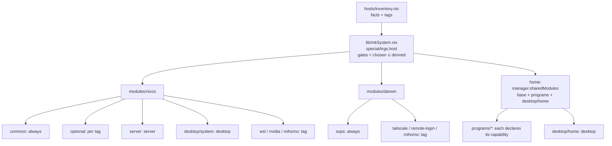

# Personal NixOS configuration context

This repository builds complete NixOS and nix-darwin systems for personal
machines, using a single flake that combines system-level modules with
user-level Home Manager modules. Composition follows **broadcast-and-gate**:
every module tree is imported by every host of its platform, and each module
decides for itself whether to activate by reading Host Metadata. Pure software
lives in `programs/`; system-side configuration lives in `modules/`.

The domain language lives in [`GLOSSARY.md`](./GLOSSARY.md). Every term below
follows it.

## Example dialogue

> **Explorer**: I want to add a new keyboard daemon for the desktop host. Where
> does it go?
>
> **Maintainer**: If it is software the user runs, create a Program Module under
> `programs/<category>/<name>/` and let the module state the capability it
> needs — `gui`, `desktop`, or `host.kind`; a program that needs none joins the
> baseline and is not gated. If it is an optional system service, create a
> System Capability under `modules/nixos/optional/` gated on a Tag, register the
> Tag in `modules/host-metadata.nix`, and tag the host. There is no switch to
> set and no software list to edit. Configuration that every NixOS host needs
> belongs in `modules/nixos/common/` instead.
>
> **Explorer**: The kitty font is too big on this machine. Where do I change it?
>
> **Maintainer**: In that host's Machine File, one line:
> `zine.programs.kitty.fontSize = 12.0;`. The knob, its type and its default live in the
> kitty module; the Machine File only assigns it. Degree differences never reach into
> upstream option paths, and `scripts/lint-structure.py` rejects them if they do.
>
> **Explorer**: Why can't I just tag a machine `desktop`?
>
> **Maintainer**: Because `desktop` is derived from `facts.form`. Machine form, GPU vendors
> and displays are facts — the world decides them, not you. `tags` holds only choices the
> hardware cannot reveal, like `docker` or `gui`. Declaring a derived capability is an
> evaluation error, so the two can never drift apart.
>
> **Explorer**: Where does a user-level systemd timer go?
>
> **Maintainer**: `modules/base/services/`, gated on a Tag. Nothing in the host
> files changes.
>
> **Explorer**: How do I turn Docker off for one host?
>
> **Maintainer**: Remove the `docker` Tag from that host. There is no switch to
> flip: the gate *is* the metadata.
>
> **Explorer**: Why is `ccache` only installed on `tianxuan` and `work-hp-laptop`?
>
> **Maintainer**: Because its module requires `host.kind == "nixos"`, and
> `macbook-air-01` is Darwin. Nothing in the host files mentions ccache.
>
> **Explorer**: What happens if I tag a host with something that does not exist?
>
> **Maintainer**: Evaluation fails. `tags` is typed as an enum over the
> vocabulary in `modules/host-metadata.nix`, so a typo is an error rather than a
> capability that silently never turns on.
>
> **Explorer**: Why are there two files per machine, and why is one usually missing?
>
> **Maintainer**: They are two module namespaces, not two copies of anything.
> `hosts/<hostname>/default.nix` is NixOS or nix-darwin and holds the machine's boot and
> hardware wiring; `hosts/<hostname>/home.nix` is Home Manager and holds only `zine.*` knob
> overrides — usually nothing, because most hosts have no degree difference. Software
> selection is Host Metadata, in the Host Inventory; `userEnvironment = true` decides whether
> a User Environment exists, and the file only says whether it deviates.

