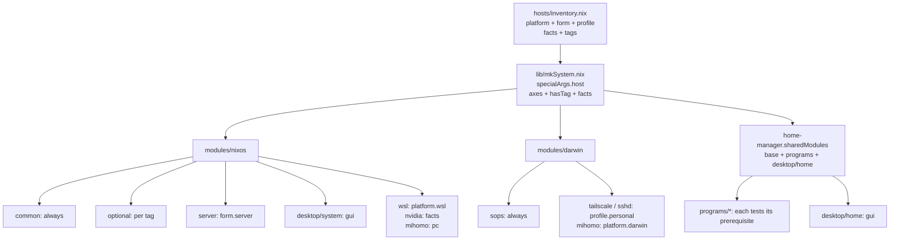

# Personal NixOS configuration context

This repository builds complete NixOS and nix-darwin systems for personal
machines, using a single flake that combines system-level modules with
user-level Home Manager modules. Composition follows **broadcast-and-gate**:
every module tree is imported by every host of its platform, and each module
decides for itself whether to activate by reading Host Metadata. Pure software
lives in `programs/`; system-side configuration lives in `modules/`.

The domain language lives in [`GLOSSARY.md`](./GLOSSARY.md). Every term below
follows it.

## Example dialogue

> **Explorer**: I want to add a new keyboard daemon for the desktop host. Where
> does it go?
>
> **Maintainer**: If it is software the user runs, create a Program Module under
> `programs/<category>/<name>/` and let the module test the prerequisite it
> needs — the `gui` label, `host.form.pc`, or `host.platform.linux`; a program with no
> prerequisite joins the baseline and is not gated. If it is an optional system service, create a
> System Capability under `modules/<name>/` and have it test
> `host.hasTag "<tag>"`; add that label to the host's `tags` in
> `hosts/inventory.nix`. There is no switch to
> set and no software list to edit. Configuration that every NixOS host needs
> belongs in `modules/nixos/common/` instead.
>
> **Explorer**: The kitty font is too big on this machine. Where do I change it?
>
> **Maintainer**: In that host's Machine File, one line:
> `zine.programs.kitty.fontSize = 12.0;`. The knob, its type and its default live in the
> kitty module; the Machine File only assigns it. Degree differences never reach into
> upstream option paths, and `scripts/lint-structure.py` rejects them if they do.
>
> **Explorer**: Why can't I just tag a machine `desktop`?
>
> **Maintainer**: Because machine form is an axis of its own: `host.form.pc`, not a Tag.
> Platform, form and profile (`host.platform` / `host.form` / `host.profile`) are separate
> typed axes; `tags` holds only labels the axes and facts cannot express, like `gui`. A typo
> in `host.form.pcc` fails at evaluation instead of silently doing nothing.
>
> **Explorer**: Where does a user-level systemd timer go?
>
> **Maintainer**: `modules/base/services/`, and the module tests the host metadata it needs.
> Nothing in the host files changes.
>
> **Explorer**: How do I turn Docker off on one host?
>
> **Maintainer**: You cannot — `virtualisation.docker` is part of the NixOS baseline, because
> every host needs it. A per-host exception would have to be a new axis value or fact, not a
> switch.
>
> **Explorer**: Why is `ccache` only installed on `tianxuan` and `work-hp-laptop`?
>
> **Maintainer**: Because its module requires `host.platform.linux`, and
> `macbook-air-01` has `platform = "darwin"`. Nothing in the host files mentions ccache.
>
> **Explorer**: What happens if I tag a host with something that does not exist?
>
> **Maintainer**: Nothing happens. `tags` is a free-form string list in
> `hosts/inventory.nix`; only `host.hasTag` reads it, so a misspelled tag is
> a label no module recognises.
>
> **Explorer**: Why are there two files per machine, and why is one usually missing?
>
> **Maintainer**: They are two module namespaces, not two copies of anything.
> `hosts/<hostname>/default.nix` is NixOS or nix-darwin and holds the machine's boot and
> hardware wiring; `hosts/<hostname>/home.nix` is Home Manager and holds only `zine.*` knob
> overrides — usually nothing, because most hosts have no degree difference. Software
> selection is Host Metadata, in the Host Inventory; `userEnvironment = true` decides whether
> a User Environment exists, and the file only says whether it deviates.

