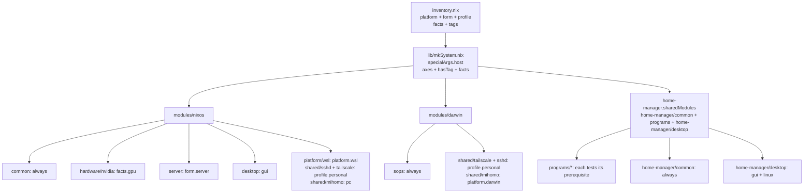

# Context and Glossary

This repository builds complete NixOS and nix-darwin systems for personal
machines, using a single flake that combines system-level modules with
user-level Home Manager modules. Composition follows **broadcast-and-gate**:
every module tree is imported by every host of its platform, and each module
decides for itself whether to activate by reading Host Metadata. Pure software
lives in `programs/`; system-side configuration lives in `modules/`.

The canonical language of this repository is the term list below. Every term
used in `AGENTS.md`, `README.md`, the ADRs, the commands, and the skills follows
this list. Use the term as written here, and avoid the words listed under
`_Avoid_`.

## Language

**Broadcast-and-Gate**:
The composition model of this repository (ADR-0014). Every module tree is imported by every
host of its platform; each module then decides for itself whether to activate, by reading
**Host Metadata**. A Host never lists what it imports, and never writes a switch for
something its own metadata already implies.
_Avoid_: opt-in modules, feature flags, plugin architecture.

**Host Metadata**:
The typed projection of a Host Inventory entry, delivered to every module as the `host`
specialArg. It has these views (ADR-0019): `host.platform`, `host.form` and `host.profile` —
each an Axis with a `name` and one boolean per vocabulary value; `host.facts`, the machine's
hardware Fact sheet; and `host.hasTag` — the predicate over the entry's `tags`. Tags are
input syntax: free-form strings with no vocabulary of their own.
_Avoid_: host config, host vars, machine profile.

**Axis**:
One of `platform` (`nixos` / `wsl` / `darwin`), `form` (`vm` / `pc` / `server`) or
`profile` (`work` / `personal`). The vocabulary lives in `lib/host-axes.nix`; each axis
projects to `{ name = "<value>"; <value> = <bool>; }`, total over its vocabulary, so a module
writes `host.form.pc` rather than comparing strings. `platform.linux` is a convenience
predicate for `nixos` or `wsl`. Axes are declared top-level in the Host Inventory and are
never Tags; a Tag cannot stand in for an Axis.
_Avoid_: kind, host type, machine profile, dimension.

**Fact**:
A machine value that comes from the world instead of from a preference, stored in the Host
Inventory's `facts`: `facts.gpu` (vendors, PRIME bus ids) and `facts.displays`. Facts are
required and typed — a missing fact is an evaluation error, never a default. Hardware facts
feed a Knob's default value; they are never part of the override chain. Machine form,
platform and profile are not in `facts`; they are Axes.
_Avoid_: host data, hardware vars, properties, attributes.

**Tag**:
A descriptive label on a Host: one free-form string in the Host Inventory entry's `tags`,
stating what the machine *is* — `gui` means this Host has a graphical session. A tag is
not a feature switch and never tells a module to turn something on; the module reads the
tag to test its own prerequisite (`host.hasTag "gui"` means "this Host has a graphical
session"). There is no vocabulary file, so a misspelled tag is a label no module recognises
and that module simply stays inert. Platform, form and profile are Axes with their own
fields; hardware belongs to Facts. Software groupings are not admissible: a tag that exists
to reproduce an old program list is that list with worse ergonomics.
_Avoid_: capability, flag, feature, switch, marker, option.

**Gate**:
The `lib.mkIf` expression through which a module tests its own prerequisite, written as
`lib.mkIf (host.hasTag "<tag>")` or `lib.mkIf host.form.pc`. It reads tags and Axes; it
never switches software on from outside. It sits inside a module body, never in `imports` —
every host evaluates every module, so a misspelled Axis predicate fails on all hosts at
once. Tree entries whose leaves cannot deactivate themselves (third-party modules,
`scanPaths` subtrees) are the only exception and must carry a
`lint-allow-imports-gate:` comment.
_Avoid_: condition, predicate, enabled flag, import switch.

**Knob**:
A typed option declared by the module that owns the setting, always with a default —
`zine.programs.kitty.fontSize`, `zine.<area>.<name>`. It is the only place a *degree*
difference between devices may live: a Machine File assigns knobs, and nothing else. Adding a
knob is justified only once a second device needs a different value.
_Avoid_: parameter, override, tweak, setting.

**Host Inventory**:
The structured mapping in `inventory.nix` (repo root) from hostname to host metadata: `system`,
`platform`, `form`, `profile`, `facts` (required), `tags`, `userEnvironment`, optional
`homeStateVersion`, optional `deploy`. It is the single source of every host difference;
`flake.nix` consumes it to build one system per host (WSL uses the NixOS build path) and to
generate deploy-rs nodes.
_Avoid_: host registry, hosts file, list.

**Host**:
A single machine configuration, represented by `hosts/<hostname>/`: `default.nix` for system
facts, an optional `home.nix` for User Environment overrides, and
`hardware-configuration.nix`. It carries no labels — those live in the Host Inventory entry — and
no axis decisions, because those are Host Inventory fields.
_Avoid_: machine, device, node.

**User Environment**:
The Home Manager configuration of the single user `zine`. `lib/mkSystem.nix` wires the Base
Layer, the Program Modules and the Desktop Layer into `home-manager.users.zine` for every
host whose Host Inventory entry sets `userEnvironment = true`, importing that host's
`hosts/<hostname>/home.nix` when it exists. Absence of the User Environment is declared in
metadata; absence of a Machine File simply means "no degree difference on this host".
_Avoid_: user entry, profile, `users/<username>/`.

**Machine File**:
`hosts/<hostname>/home.nix`. The Machine File assigns `zine.*` Knobs only — a font size, a
layout choice — because those are the differences that can be neither gated nor derived.
Whether a program belongs to a host follows from that Host's labels and Axes, tested inside
the Program Module itself; hardware differences live in Facts. The file is optional: hosts without a degree difference have no Machine File at all.
What makes the User Environment exist is `userEnvironment = true`, not the file's presence.
_Avoid_: host file, organization file, home module, switch table.

**Program Module**:
A self-contained directory `programs/<category>/<name>/`. It owns that program's installation
and configuration, and it decides for itself whether it belongs by testing the prerequisite
it needs: `lib.mkIf (host.hasTag "gui")`, `lib.mkIf host.platform.linux`, `lib.mkIf host.form.pc`,
and so on. A program with no prerequisite is part of the User Environment baseline and
is not gated at all (`config = { … };`). Native configuration files and an optional
`package.nix` live in the same directory. Nothing lists programs per host.
_Avoid_: package config, app config, install side, entry.

**Category**:
One of `shell`, `terminal`, `dev`, `gui`, `misc` under `programs/`. Categories group by kind
of software, never by platform.
_Avoid_: group, bundle, platform.

**Package Recipe**:
`package.nix` inside a program directory (or, for a package consumed by a system module,
inside its system module directory). The flake exposes it as `.#<directory-name>`, which is
also the name `nix-update --flake <name>` uses.
_Avoid_: custom package, pkgs entry, derivation file.

**Base Layer**:
`modules/home-manager/common/`, the platform-independent Home Manager layer: state version and
agent skills, both ungated baseline. `lib/mkSystem.nix` adds `modules/home-manager/` to every
User Environment, so hosts and Machine Files never import it.
_Avoid_: common home, shared user layer, `modules/home`.

**Desktop Layer**:
The desktop subsystem, one half per layer: `modules/home-manager/desktop/` is the user-level
Wayland desktop (niri, DankMaterialShell, fonts, icon theme, XDG user dirs) and
`modules/nixos/desktop/` is the matching NixOS configuration (greetd, portal, audio,
bluetooth, graphics, input method, nixpak, Steam). Both halves gate on `host.hasTag "gui"`
(plus `host.platform.linux` for the user half), and the system half is imported wholesale
because the third-party modules it pulls in cannot deactivate themselves.
_Avoid_: DE, WM config, desktop stack.

**System Module**:
A module under `modules/nixos/` or `modules/darwin/`, keyed by platform. It configures the
machine, not the user.
_Avoid_: platform config, host layer.

**System Capability**:
A module that is inert unless the Host metadata satisfies its precondition —
`modules/shared/tailscale/`, `modules/shared/sshd.nix`, `modules/nixos/hardware/nvidia.nix`. It declares no
option: the gate is `lib.mkIf (host.hasTag "<tag>")`, `lib.mkIf host.profile.personal`
or `lib.mkIf host.form.server`, so the module cannot drift from the metadata it tests.
Configuration that every host of a platform needs belongs in `modules/nixos/common/`,
not here.
_Avoid_: feature flag, addon, plugin.

**Command**:
A prompt template in `programs/dev/pi/prompts/`, installed as `/<name>`. It answers the *when*: which
skills run, in which order, with which arguments, behind which gate. Its `## Routing` table names the
situation that switches to another skill.
_Avoid_: entry point, slash command (use command), workflow.

**Skill**:
A directory `skills/<command>/<name>/` holding `SKILL.md`. It answers the *how*: the procedure, the
bar, and the exit criteria. `principles/` and `tools/` hold skills that no single command owns.
_Avoid_: prompt, playbook, recipe.

## Example dialogue

> **Explorer**: I want to add a new keyboard daemon for the desktop host. Where
> does it go?
>
> **Maintainer**: If it is software the user runs, create a Program Module under
> `programs/<category>/<name>/` and let the module test the prerequisite it
> needs — the `gui` label, `host.form.pc`, or `host.platform.linux`; a program with no
> prerequisite joins the baseline and is not gated. If it is an optional system service, create a
> System Capability under `modules/shared/` (both platforms) and have it test
> `host.hasTag "<tag>"`; add that label to the host's `tags` in
> `inventory.nix`. There is no switch to
> set and no software list to edit. Configuration that every NixOS host needs
> belongs in `modules/nixos/common/` instead.
>
> **Explorer**: The kitty font is too big on this machine. Where do I change it?
>
> **Maintainer**: In that host's Machine File, one line:
> `zine.programs.kitty.fontSize = 12.0;`. The knob, its type and its default live in the
> kitty module; the Machine File only assigns it. Degree differences never reach into
> upstream option paths, and `scripts/lint-structure.py` rejects them if they do.
>
> **Explorer**: Why can't I just tag a machine `desktop`?
>
> **Maintainer**: Because machine form is an axis of its own: `host.form.pc`, not a Tag.
> Platform, form and profile (`host.platform` / `host.form` / `host.profile`) are separate
> typed axes; `tags` holds only labels the axes and facts cannot express, like `gui`. A typo
> in `host.form.pcc` fails at evaluation instead of silently doing nothing.
>
> **Explorer**: Where does a user-level systemd timer go?
>
> **Maintainer**: `modules/home-manager/common/`, and the module tests the host metadata it needs.
> Nothing in the host files changes.
>
> **Explorer**: How do I turn Docker off on one host?
>
> **Maintainer**: You cannot — `virtualisation.docker` is part of the NixOS baseline, because
> every host needs it. A per-host exception would have to be a new axis value or fact, not a
> switch.
>
> **Explorer**: Why is `ccache` only installed on `tianxuan` and `work-hp-laptop`?
>
> **Maintainer**: Because its module requires `host.platform.linux`, and
> `macbook-air-01` has `platform = "darwin"`. Nothing in the host files mentions ccache.
>
> **Explorer**: What happens if I tag a host with something that does not exist?
>
> **Maintainer**: Nothing happens. `tags` is a free-form string list in
> `inventory.nix`; only `host.hasTag` reads it, so a misspelled tag is
> a label no module recognises.
>
> **Explorer**: Why are there two files per machine, and why is one usually missing?
>
> **Maintainer**: They are two module namespaces, not two copies of anything.
> `hosts/<hostname>/default.nix` is NixOS or nix-darwin and holds the machine's boot and
> hardware wiring; `hosts/<hostname>/home.nix` is Home Manager and holds only `zine.*` knob
> overrides — usually nothing, because most hosts have no degree difference. Software
> selection is Host Metadata, in the Host Inventory; `userEnvironment = true` decides whether
> a User Environment exists, and the file only says whether it deviates.

## Composition map

